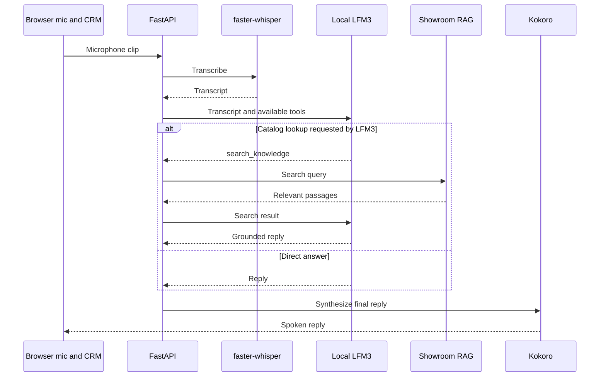

# Tata showroom voice agent

A local English and Hindi voice desk for the Fortivex prototype. The browser captures laptop microphone audio and plays local speech. The CRM stores transcripts and test-drive bookings in SQLite. The supplied Tata RAG service retrieves passages from the included showroom catalog.

## Run on this PC

If the local runtime and model files are in place, start the voice app and LFM3 together:

```powershell
.\.venv\Scripts\python.exe run.py
```

Open [the voice desk](http://127.0.0.1:8001). The launcher uses an existing local LLM server on port 8080 or starts the bundled Windows runtime when its files are present. The launcher also starts the Tata RAG service on port 8000 and its knowledge admin on port 8502.

## Set up on another Windows PC

Use PowerShell in this folder with Python 3.11 or 3.12.

```powershell
py -3.12 -m venv .venv
.\.venv\Scripts\python.exe -m pip install --upgrade pip
.\.venv\Scripts\python.exe -m pip install torch --index-url https://download.pytorch.org/whl/cpu
.\.venv\Scripts\python.exe -m pip install -r requirements.txt
.\.venv\Scripts\python.exe -m showroom.prepare_models
```

The preparation command downloads the multilingual Whisper checkpoint, the Kokoro voice assets, and the English tokenizer model on first use. It prepares the English, Hindi, and bilingual welcome clips locally. The speech cache is stored under `runtime/huggingface`. Run the app offline after preparing both speech models and LFM3.

In a second PowerShell window, use a recent Windows build of [llama.cpp](https://github.com/ggml-org/llama.cpp/releases). The Windows x64 Vulkan or CUDA build can use the GTX 1650. Use `llama-server --list-devices` to identify the NVIDIA device when the laptop also lists integrated graphics. Start the local model server:

```powershell
llama serve -hf LiquidAI/LFM3-1.7B-GGUF:Q4_K_M --alias showroom --host 127.0.0.1 --port 8080 --ctx-size 4096 --n-gpu-layers 99 --reasoning off --jinja
```

The first run downloads LFM3. Subsequent runs use the cached files. Typed messages use the same LFM3 assistant without requiring the speech models.

If you launch services manually, start the RAG service with its `run_server.bat`, then start this app:

```powershell
.\.venv\Scripts\python.exe -m uvicorn showroom.main:app --host 127.0.0.1 --port 8001
```

Open [the voice desk](http://127.0.0.1:8001) in Edge or Chrome. Click **Start conversation** and let the welcome finish, then click **Start microphone**. Click **Stop and send** at the end of each turn and allow browser microphone access when prompted. The text box exercises the same dialogue flow. Choose English or Hindi manually if a short or mixed-language opening is ambiguous.

## RAG setup on another Windows PC

From the project root, create the RAG environment and download its multilingual embedding model once.

```powershell
python -m venv --system-site-packages runtime\rag-venv
.\runtime\rag-venv\Scripts\python.exe -m pip install -r .\RAG__FORTIVEX_AI\requirements.txt
$env:HF_HOME = Join-Path (Get-Location) 'runtime\huggingface'
.\runtime\rag-venv\Scripts\python.exe -c "from sentence_transformers import SentenceTransformer; SentenceTransformer('sentence-transformers/paraphrase-multilingual-MiniLM-L12-v2', device='cpu')"
```

`run.py` launches RAG with the model cache in offline mode. It opens the supplied `chroma_showroom_db` in the RAG folder. The Knowledge admin page runs on port 8502 and manages PDFs and staff notes through the RAG API.
## RAG contract

LFM3 receives the caller’s words first. If it requests `search_knowledge`, the voice app sends the model’s query and a passage limit to `POST http://127.0.0.1:8000/rag/query`. The app sends the matches back to LFM3 as a tool result and speaks the final answer.

```json
{"query":"Tata Safari seating capacity","top_k":3,"model":"safari"}
```

The RAG service supplies passages and optional one-based page numbers. Return `{"matches": []}` for an unsupported query.

```json
{"matches":[{"text":"…","source":"Tata_India_Current_Car_Lineup_November_2026.pdf","page":10,"model":"safari","year":2026}]}
```

When the question names a single indexed Tata model, the app adds the canonical model filter to the lookup. English and Hindi model names are supported. For a standalone demo with fictional Aster records, explicitly set `SHOWROOM_DEMO_FALLBACK=1`.

| Setting | Default |
|---|---|
| `SHOWROOM_RAG_URL` | `http://127.0.0.1:8000` |
| `SHOWROOM_RAG_ADMIN_URL` | `http://127.0.0.1:8502` |
| `SHOWROOM_LLM_URL` | `http://127.0.0.1:8080` |
| `SHOWROOM_LLM_MODEL` | `showroom` |
| `SHOWROOM_WHISPER_MODEL` | `base` |
| `SHOWROOM_DB` | `runtime/showroom.sqlite3` |
| `SHOWROOM_DEMO_FALLBACK` | `0` |

## Demo

1. Check for **LFM3 ready** and **RAG ready**, then ask **Who are you?** for a direct answer or **How many seats does the Tata Safari have?** for a catalog lookup. Replies generated by the model carry an **LLM-generated** label. Open **Retrieved sources** to see the passage and page number when supplied.
2. Say **I want to book a test drive for the Tata Nexon**. Choose an offered option, give a fictional name and 10-digit callback number, and confirm. The appointment is saved when the database accepts the slot. Slots are displayed in IST.
3. End the conversation. Open **CRM** and select the call to see both speakers' turns and the booking reference.
4. Repeat in Hindi. Try **टाटा नेक्सन में कितने एयरबैग हैं?** and test a mixed-language request separately.

## Architecture



The browser uses push-to-talk. Whisper also applies VAD within each clip to remove silence. LFM3 can request the start of a booking. Python then checks availability, collects the booking details and accepts an explicit confirmation before saving. A unique database constraint protects each slot. The demo schedule has one shared test-drive resource and offers times over the next seven days. The CRM stores text from both speakers, retrieved sources, and a short outcome summary. Use fictional customer data while running the demo.


## Optional Gemini Live demo mode

Use an API key from a Gemini Developer API project on the Free tier with billing disabled. The app cannot determine the project's billing tier from its key. Confirm that Gemini 3.8 Live is available in that project's free quota. The API key stays in the server environment.

Start from PowerShell in the project directory. Paste the key at the masked prompt.

```powershell
.\.venv\Scripts\python.exe -m pip install 'websockets>=14,<17'
$env:GEMINI_API_KEY = [System.Net.NetworkCredential]::new('', (Read-Host 'Gemini API key' -AsSecureString)).Password
.\.venv\Scripts\python.exe run.py
```

Choose Gemini Live in the Voice mode control.. Start a conversation and click Start microphone. Use headphones if speaker audio interrupts listening. To switch back, pause the microphone and select Local. If the online connection fails, the app selects Local and you can restart the microphone in the same conversation.

Gemini streams microphone audio and spoken answers. It can call the existing Tata knowledge lookup. Completed transcribed exchanges and sources are saved to the local CRM. If the customer requests a test drive, the microphone switches automatically to local mode for slot selection and confirmation. You can say choices such as “I want to go with the first option”. Use fictional details for online demos because audio is processed by Google. Use local mode for sensitive conversations.
