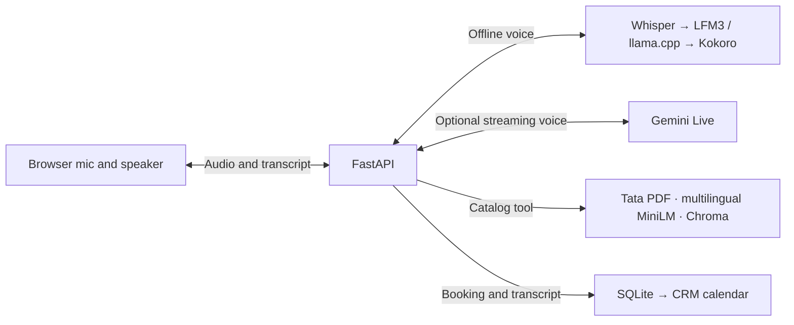

# Autonomous AI Sales Voice Agent

**FORTIVEX AI PRIVATE LIMITED · Round 3 · OC.44671.2027.65164**

**Business problem.** Car showrooms repeatedly answer questions about specifications and variants while coordinating test drives and following up on enquiries. This prototype provides an English and Hindi voice desk for answering catalog questions, booking test drives, and preserving the conversation for staff.

**Architecture and implementation**

FastAPI coordinates speech, retrieval, and bookings. For car facts, the model calls the Tata catalog tool and answers from retrieved passages with page references. A Python state machine handles appointment choices and explicit confirmation, and SQLite prevents double-booking a slot. Gemini Live hands test-drive requests to the local voice workflow. Recent conversation context and booking state support follow-up turns. The CRM displays saved transcripts, sources, and booking outcomes.

**End-to-end demo.** Ask about Tata Safari seating, check the cited page, then request a Tata Nexon test drive. Say “I want to go with the first option,” provide fictional details, and confirm by voice. End the call and open the customer’s booking and conversation from the CRM calendar. See the [setup and demo instructions](README.md).

**Commercial feasibility.** Pilot the system with one dealership. Measure answer accuracy, response latency, abandoned enquiries, completed bookings, and staff time saved. A per-showroom subscription is viable if the observed value exceeds hosting, onboarding, integration, and support costs.

**Scaling to 100,000 users.** For planning, assume 100,000 registered users, 1% active at peak, and two turns per active user per minute. That implies roughly 33 turns per second. Use load-balanced API replicas, central session state and PostgreSQL, independently scaled voice and inference workers, and a separate retrieval service. Size replicas using load tests and measured latency. These figures are planning assumptions.

**Security, deployment, and costs.** The MVP runs on one Windows laptop with an offline mode. Use fictional details with Gemini Live and keep API keys in server environment variables. A hosted pilot needs HTTPS, tenant-scoped access, encrypted storage and backups, retention controls, and monitored deployments. Budget for inference, database, storage, bandwidth, and support. Compare monthly cost per completed conversation. Demo API usage can stay within eligible free-tier quotas.
